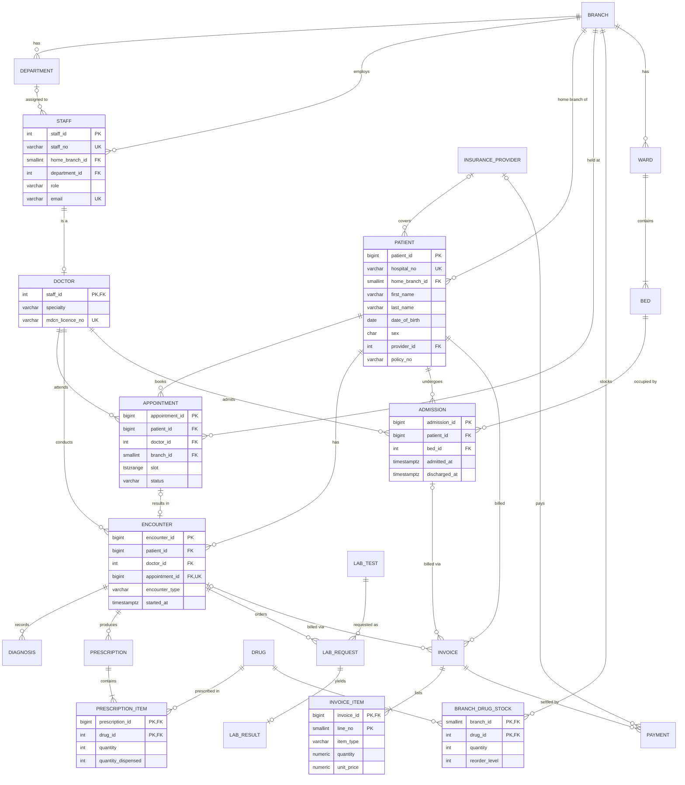

# Portfolio 1: Database Design and Modelling

**Case study:** Lagoon Care Specialist Hospital (simulated multi-branch private hospital, Lagos)
**DBMS:** PostgreSQL 16

## 1. Case study statement

| Item | Description |
|---|---|
| **Organisation** | Lagoon Care Specialist Hospital, a simulated private hospital group with branches in Ikeja, Lekki and Yaba, Lagos. |
| **Nature of the system** | An integrated hospital information system covering outpatient clinics, emergency, inpatient wards, laboratory, pharmacy and billing, including HMO/NHIA insurance. Patients may attend any branch using one hospital number. |
| **Database users** | Receptionists, doctors, nurses, lab scientists, pharmacists, billing officers and administrators. |
| **Major data stored** | Branches, departments, staff and doctors, patients, insurance providers, appointments, encounters (consultations), diagnoses, drugs and branch stock, prescriptions, lab tests, requests and results, wards, beds, admissions, invoices and payments. |
| **Key operations** | Register patients, book appointments, record consultations and diagnoses, prescribe and dispense drugs, request and record lab tests, admit and discharge patients, invoice and receive payments, and retrieve a patient's full history across branches. |

## 2. Files

| File | Purpose |
|---|---|
| `schema.sql` | Full schema: 20 tables, 1 view, all keys and constraints |
| `constraint_tests.sql` | Valid sample data, plus 10 inserts that deliberately break business rules |
| `constraint_tests_output.txt` | Output from running the tests, showing each rule being enforced |
| `er_diagram.png` | Rendered ER diagram (same content as section 3) |

**How to run**

```bash
createdb lagoon_care
psql -d lagoon_care -f schema.sql
psql -d lagoon_care -f constraint_tests.sql
```

## 3. ER diagram



*Only the main tables show attributes, to keep the diagram readable. `schema.sql` has every column.*

## 4. Relational schema (summary)

Notation: PK = primary key, FK = foreign key, UK = unique (alternate) key.

- **branch**(branch_id PK, branch_code UK, name UK, address, city, phone, opened_on)
- **department**(department_id PK, branch_id FK, name), UNIQUE(branch_id, name)
- **staff**(staff_id PK, staff_no UK, home_branch_id FK, department_id FK, first_name, last_name, role, email UK, phone, hire_date, is_active)
- **doctor**(staff_id PK/FK→staff, specialty, mdcn_licence_no UK)
- **insurance_provider**(provider_id PK, name UK, provider_type, phone)
- **patient**(patient_id PK, hospital_no UK, home_branch_id FK, names, date_of_birth, sex, blood_group, contact fields, provider_id FK, policy_no), UNIQUE(provider_id, policy_no)
- **appointment**(appointment_id PK, patient_id FK, doctor_id FK→doctor, branch_id FK, slot, status, reason, booked_by FK→staff)
- **encounter**(encounter_id PK, patient_id FK, doctor_id FK, branch_id FK, appointment_id FK UK, encounter_type, started_at, chief_complaint, clinical_notes)
- **diagnosis**(diagnosis_id PK, encounter_id FK, icd10_code, description, is_primary), UNIQUE(encounter_id, icd10_code)
- **drug**(drug_id PK, nafdac_no UK, generic_name, brand_name, dosage_form, strength, unit_price)
- **branch_drug_stock**(branch_id PK/FK, drug_id PK/FK, quantity, reorder_level)
- **prescription**(prescription_id PK, encounter_id FK, prescribed_at, status)
- **prescription_item**(prescription_id PK/FK, drug_id PK/FK, dose, frequency, duration_days, quantity, quantity_dispensed)
- **lab_test**(test_id PK, test_code UK, name, specimen_type, price)
- **lab_request**(request_id PK, encounter_id FK, test_id FK, requested_at, priority, status), UNIQUE(encounter_id, test_id)
- **lab_result**(request_id PK/FK, recorded_by FK→staff, recorded_at, summary, is_abnormal)
- **ward**(ward_id PK, branch_id FK, name, ward_type, daily_rate), UNIQUE(branch_id, name)
- **bed**(bed_id PK, ward_id FK, bed_label, is_in_service), UNIQUE(ward_id, bed_label)
- **admission**(admission_id PK, patient_id FK, bed_id FK, admitting_doctor_id FK, encounter_id FK, admitted_at, discharged_at, discharge_summary)
- **invoice**(invoice_id PK, invoice_no UK, patient_id FK, branch_id FK, encounter_id FK, admission_id FK, issued_at, status)
- **invoice_item**(invoice_id PK/FK, line_no PK, item_type, description, quantity, unit_price)
- **payment**(payment_id PK, invoice_id FK, amount, method, provider_id FK, reference UK, received_by FK, paid_at)
- **invoice_balance**: a view that calculates total, paid and balance due

## 5. Keys and design decisions

- **Surrogate keys:** most tables use `GENERATED ALWAYS AS IDENTITY` keys. Natural identifiers such as `hospital_no`, `staff_no`, `mdcn_licence_no`, `nafdac_no` and `invoice_no` are kept as **UNIQUE alternate keys**. Natural keys can change (e.g. a reissued card), and surrogate keys keep foreign keys small and stable.
- **Composite keys** are used where the relationship *is* the entity: `branch_drug_stock(branch_id, drug_id)`, `prescription_item(prescription_id, drug_id)` and `invoice_item(invoice_id, line_no)`.
- **Specialisation (IS-A):** `doctor` shares its primary key with `staff`. Doctor-only attributes (specialty, licence) don't create NULL columns for nurses or receptionists. Appointments reference `doctor`, not `staff`, so the database rejects a booking with a non-doctor (Test 6).
- **Multi-branch design:** `branch_id` is carried on patients (home branch), appointments, encounters, stock, wards and invoices. A patient keeps **one hospital number across all branches**, and branch-level data such as stock and beds stays separate. This prepares the data for sharding by branch in Portfolio 5.
- **Doctors can work at more than one branch.** `staff.home_branch_id` records where someone is employed, but visiting consultants often run clinics at other branches. So `appointment.branch_id` and `encounter.branch_id` record where the visit *actually* happened. They are independent facts, not values derivable from the doctor, so storing them does not break 3NF.
- **Prices are copied at billing time** (`invoice_item.unit_price`). This is intentional, not redundancy: a later change in a drug's price must not alter an invoice already issued.

## 6. Constraints that enforce hospital business rules

| Business rule | How it is enforced | Test |
|---|---|---|
| A doctor cannot have two overlapping appointments | `EXCLUDE USING gist (doctor_id WITH =, slot WITH &&)` on active appointments | 1 |
| Drug stock can never go negative | `CHECK (quantity >= 0)` | 2 |
| A bed cannot hold two patients at the same time | `EXCLUDE` on `tstzrange(admitted_at, discharged_at)` per bed | 3 |
| Valid domain values (sex, blood group, roles, statuses) | `CHECK ... IN (...)` | 4 |
| Hospital numbers are unique group-wide | `UNIQUE (hospital_no)` | 5 |
| Only doctors can be booked for appointments | FK `appointment.doctor_id → doctor` | 6 |
| A policy number requires an insurance provider | `CHECK (policy_no IS NULL OR provider_id IS NOT NULL)` | 7 |
| One primary diagnosis per encounter | Partial unique index `WHERE is_primary` | 8 |
| Discharge must come after admission | `CHECK (discharged_at > admitted_at)` | 9 |
| Insurance payments must name the provider | `CHECK (method <> 'insurance' OR provider_id IS NOT NULL)` | 10 |
| Cannot dispense more than prescribed | `CHECK (quantity_dispensed BETWEEN 0 AND quantity)` | n/a |
| A patient has at most one open admission | Partial unique index `WHERE discharged_at IS NULL` | n/a |

Every "SHOULD FAIL" test was rejected with the expected constraint error. The adjacent-slot test (1b) succeeded, because ranges are half-open `[start, end)`. See `constraint_tests_output.txt`.

## 7. Normalisation

The schema is in **Third Normal Form (3NF)** and, for every table checked, **Boyce-Codd Normal Form (BCNF)**.

**Starting point: an unnormalised "visit record"**, as a paper hospital card might store it:

```
VISIT(hospital_no, patient_name, dob, phone, hmo_name, hmo_phone, visit_date,
      doctor_name, doctor_specialty, branch_name, branch_address,
      diagnoses{code, description},
      drugs{drug_name, strength, price, qty, dose},
      lab_tests{test_code, test_name, test_price, result})
```

**1NF: remove repeating groups.** Diagnoses, drugs and lab tests are repeating groups inside one visit. They move to their own tables, each row holding single (atomic) values: `diagnosis`, `prescription_item` and `lab_request`, each linked to `encounter`.

**2NF: remove partial dependencies.** In `prescription_item` with key (prescription_id, drug_id), attributes such as `generic_name`, `strength` and `unit_price` depend on `drug_id` alone, which is only part of the key. They move to `drug`. In the same way, `test_name` and `price` depend only on `test_id` and move to `lab_test`. Only facts about the *pair* stay, such as dose, frequency and quantity.

**3NF: remove transitive dependencies.**
- `encounter → patient_id → patient_name, dob, phone`: patient details move to `patient`.
- `patient → provider_id → hmo_name, hmo_phone`: insurer details move to `insurance_provider`.
- `encounter → doctor_id → specialty`: doctor details move to `doctor` and `staff`.
- `encounter → branch_id → branch_address`: branch details move to `branch`.
- `bed → ward_id → daily_rate, branch_id`: the rate is a property of the ward, not of each bed.

**BCNF check.** In each table, every determinant is a candidate key. For example, in `department` the only non-trivial dependencies are `department_id → *` and `(branch_id, name) → *`, and both are keys.

**Derived data is not stored.** Invoice totals and balances depend on `invoice_item` and `payment`. Storing them would create an update anomaly: adding a payment without updating the total. They are calculated in the `invoice_balance` view instead.

**Anomalies avoided:**
- *Update:* changing an HMO's phone number happens in exactly one row.
- *Insert:* a new drug or lab test can be added before anyone is prescribed or tested.
- *Delete:* deleting a patient's only visit does not lose the doctor's or the drug's details.

**Deliberate exceptions.** `invoice_item.unit_price` holds the price *at the time of billing*, which is a historical fact rather than a duplicate of `drug.unit_price`. Test-specific lab values (e.g. a full blood count has ~15 fields; a malaria test has 1) are not forced into relational tables. They are modelled as documents in Portfolio 4.
