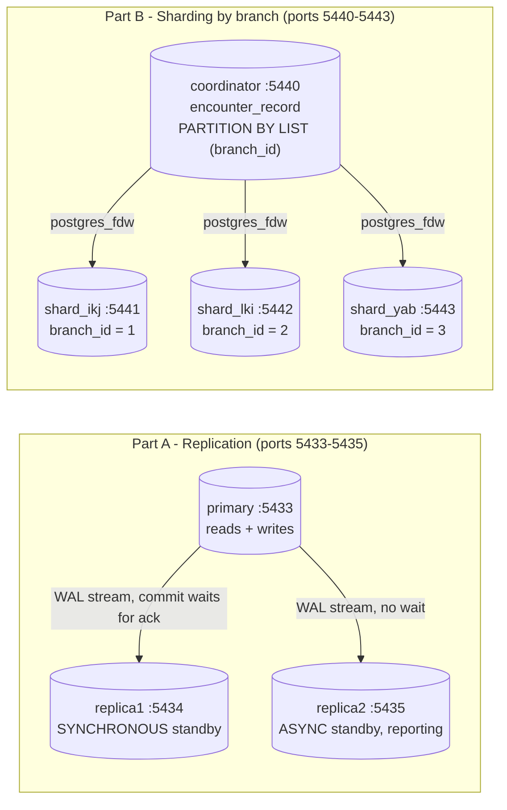

# Portfolio 5: Distributed and Cloud Database Exercise

**Case study:** Laguna Care Specialist Hospital (Ikeja, Lekki and Yaba branches)
**Technology:** PostgreSQL 15: streaming replication, synchronous/quorum commit, failover, and sharding with `postgres_fdw` + declarative partitioning

## 1. Problem

The hospital group's database must:
1. **Stay available** if a server or data centre fails. Doctors can't stop treating patients because a disk died.
2. **Never lose a committed clinical or billing record.**
3. **Serve three branches,** each mostly using its own data, but with group-wide reporting and patients who visit more than one branch.

This portfolio builds and tests two distributed designs on one computer, using **7 real PostgreSQL servers** on different ports:
- **Part A: replication.** One primary and two standbys, for availability and durability.
- **Part B: sharding.** A coordinator and three branch shards, for horizontal scale.

## 2. Architecture



## 3. Files

| File | Purpose |
|---|---|
| `01_replication.sh` | Builds the primary and 2 standbys, then runs demos 1–7 below |
| `02_sharding.sh` | Builds the coordinator and 3 shards, then runs demos 1–9 below |
| `sharding/shard_table.sql` | Table on each shard, with `CHECK (branch_id = N)` |
| `sharding/coordinator.sql` | `postgres_fdw` servers and the partitioned table whose partitions are foreign tables |
| `sharding/load_data.sql` | 30,000 encounters inserted through the coordinator |
| `03_stop_all.sh` | Stops all 7 servers and deletes `cluster/` |
| `results/replication_output.txt`, `results/sharding_output.txt` | Full output of both runs |

**How to run:**
```bash
./01_replication.sh && ./02_sharding.sh && ./03_stop_all.sh
```
- On Windows, use Git Bash with `PATH` set as in Portfolio 2.
- The scripts use ports 5433–5443 and their own `cluster/` folder, so your normal PostgreSQL on 5432 is untouched.
- Both scripts together take about 2 minutes.

## 4. Part A: replication, consistency and failover

| Step | What was done | Observed (see `results/replication_output.txt`) |
|---|---|---|
| 1–2 | Primary created; two standbys cloned with `pg_basebackup -X stream -R -C -S` (physical copy + replication slot) | Both standbys streaming |
| 3 | `pg_stat_replication` on the primary | replica1 `sync_state = sync`, replica2 `async`; standbys report `pg_is_in_recovery() = t` |
| 4 | Patient LCH-0005001 registered on the primary | Visible on **both** standbys within 0.5 s, so reads can be spread across 3 servers |
| 5 | INSERT attempted on replica1 | `ERROR: cannot execute INSERT in a read-only transaction` |
| 6a | **replica1 (the synchronous standby) stopped**, then a patient registered on the primary | The client **hung**. `pg_stat_activity` showed `wait_event = SyncRep`. On cancel: *"The transaction has already committed locally, but might not have been replicated to the standby."* |
| 6b | Switched to **quorum** commit: `synchronous_standby_names = 'ANY 1 (replica1, replica2)'` | The next write committed immediately, confirmed by replica2 (`sync_state = quorum`) |
| 6c | replica1 restarted | It caught up automatically from its replication slot (2 of 2 missed rows received) |
| 7 | An appointment was booked, then the **primary was killed** (`pg_ctl stop -m immediate`) and replica1 **promoted** | The appointment was present on the new primary: **zero data loss (RPO = 0)**. New writes were accepted. replica2 was re-pointed at the new primary and kept streaming. The new primary writes WAL on **timeline 2**. |

### What this shows
- **Synchronous replication puts consistency before availability.** In step 6a, losing one standby stopped *every* write on the primary, because PostgreSQL will not report success until a second copy exists. That is exactly what makes step 7's zero-loss failover possible.
- **The cancelled write in 6a was still committed locally.** The client was not told "success", yet the row exists. An application must treat a cancelled synchronous commit as *"unknown outcome"*, never as *"failed"*. Retrying blindly could register the patient twice; the unique `hospital_no` from Portfolio 1 would catch that.
- **Quorum commit (`ANY 1`) is the practical balance.** Every commit is still on at least 2 servers, but any single standby can fail without stopping writes. For the hospital: **3 nodes, `ANY 1 (replica1, replica2)`**.
- **Asynchronous replicas trade freshness for speed.** replica2 never slows down commits, but it can lag behind the primary. A receptionist who registers a patient and immediately searches on replica2 might not find them. Reads that must see the user's own write go to the primary. `synchronous_commit = remote_apply` is another option for that.
- **Failover is not complete without re-pointing.** Promotion starts a new timeline. Other standbys must follow it; that worked here because replica2 had not gone past the fork point. The old primary must be rebuilt (`pg_rewind` or a fresh base backup) before it can rejoin. Otherwise there would be **two primaries** (split brain).

## 5. Part B: sharding by branch

The shard key is **`branch_id`**. The coordinator's `encounter_record` table is `PARTITION BY LIST (branch_id)`, and each partition is a `postgres_fdw` foreign table on a different server.

| Step | What was done | Observed (see `results/sharding_output.txt`) |
|---|---|---|
| 4 | 30,000 encounters inserted **through the coordinator** | Routed automatically: **IKJ 15,023, LKI 9,053, YAB 5,927** rows; each shard holds only its own `branch_id` |
| 5 | Lekki-only report for 2026 | `EXPLAIN` shows **one** Foreign Scan, on `encounter_lki` (partition pruning). The `WHERE` filter is **pushed down** in the Remote SQL. Result: 4,153 visits. |
| 6 | Group-wide revenue per branch | **Async Foreign Scan** on all 3 shards *in parallel*. `count(*)` and `sum(amount)` are computed **on each shard** (`Relations: Aggregate on ...`), so only 3 rows travel to the coordinator. |
| 7 | One patient's history (`hospital_no`, not the shard key) | **Scatter-gather:** all 3 shards queried. Patient LCH-0000013 has visits at all 3 branches. |
| 8 | A Lekki row inserted directly into the Ikeja shard | Rejected by the shard's `CHECK (branch_id = 1)` |
| 9 | **Lekki shard stopped** | Ikeja queries still work (15,023 rows). The group-wide query fails with *could not connect to server "shard_lki"*. After restart, all 30,003 rows are back. |

### Evaluation of the shard key

**Strengths of `branch_id`:**
- **Data locality:** almost all daily work (clinic lists, stock, billing) is per branch and hits one shard.
- **Fault isolation:** one branch's outage doesn't stop the others (step 9).
- **Data-residency control:** each branch's data sits on a known server.

**Weaknesses of `branch_id`:**
- **Cross-branch patients need scatter-gather.** Patient history (step 7) asks every shard, because patients visit several branches. A global index on `hospital_no`, or a replicated patient directory, would fix this.
- **Uneven shards.** Ikeja holds 50% of the data and is the hot spot. Shard keys like `hash(hospital_no)` spread load evenly, but lose branch locality.
- **No atomic cross-shard transactions.** `postgres_fdw` has no two-phase commit, so a stock transfer between two branch shards (Portfolio 3, s10) would not be atomic. Cross-shard writes need two-phase commit or a saga pattern; Citus provides this.
- **Re-sharding is hard,** e.g. when a fourth branch opens or Ikeja outgrows its server.

**Honest recommendation:**
- At the hospital's current size (about 3.3 million rows, well under 1 GB in Portfolio 2), **sharding is not needed yet**. One primary with quorum replicas (Part A) handles the load, and keeps foreign keys, joins and the Portfolio 3 transactions working across all data.
- Part B is the **scale-out path** for when the group grows to many branches or one server can no longer keep up. In production, the **Citus** extension provides the same design with distributed transactions and rebalancing.

## 6. CAP and PACELC applied to the hospital

| Situation | Choice made | Where demonstrated |
|---|---|---|
| **Partition or standby failure** (CAP): consistency or availability? | **Consistency** for clinical and billing writes: synchronous/quorum commit refuses to confirm until a second copy exists | 6a: the write blocked |
| **Else, normal operation** (PACELC): latency or consistency? | **Consistency**: every commit pays one network round trip to a standby | Quorum commit in 6b |
| Reporting and dashboards | **Availability/latency**: an asynchronous replica may be slightly stale | replica2 |
| Branch shard down | **Partial availability**: other branches carry on | Part B, step 9 |
| Redis queue and bed board (Portfolio 4) | **Availability**: can be rebuilt from PostgreSQL | Portfolio 4 |

## 7. Cloud deployment design

The same architecture maps directly onto a managed cloud database service, such as Azure Database for PostgreSQL Flexible Server, Amazon RDS / Aurora PostgreSQL, or Google Cloud SQL:

| Local demo | Cloud equivalent |
|---|---|
| primary + synchronous replica1 | **High availability across availability zones:** a synchronous standby in a second zone, with automatic failover |
| asynchronous replica2 | **Read replica**, optionally in another region, for reporting and disaster recovery |
| manual `pg_ctl promote` | Managed automatic failover; applications reconnect through one DNS endpoint |
| `pg_basebackup` + replication slot | Managed backups with **point-in-time recovery** (continuous WAL archiving) |
| coordinator + shards | A managed distributed PostgreSQL service based on Citus, when needed |
| MongoDB / Redis (Portfolio 4) | MongoDB Atlas replica set; a managed Redis cache with a replica |

**Proposed targets:**
- **RPO = 0** for committed clinical and billing data (synchronous zone-redundant standby).
- **RTO under about 2 minutes** (automatic failover).
- Daily backups plus continuous WAL kept for 35 days.

**Cloud-specific concerns for a Nigerian hospital:**
- **Data protection.** Patient health data is sensitive personal data under the Nigeria Data Protection Act 2023. The hosting region, any cross-border transfer, encryption at rest and in transit, access control and audit logging must all comply.
- **Latency.** The distance from each branch to the cloud region adds to every synchronous commit. That favours a region or data centre close to Lagos, with synchronous standbys inside one region and only asynchronous replicas further away.
- **Connectivity.** Branches must keep working if their internet link fails. This is one argument for branch-local shards or local read replicas.
- **Cost.** A synchronous standby doubles the database cost. It is justified for clinical data; non-critical data (reports, cache) can use cheaper asynchronous replicas.

## 8. Limitations

- All 7 servers ran on **one computer**, so network delay, real partitions and disk failures were simulated, not real. Lag figures are therefore near zero.
- Failover was **manual**. Production needs an automatic failover manager (Patroni, or the cloud provider's) plus fencing to prevent split brain.
- The sharded table is a simplified `encounter_record`, not the full Portfolio 1 schema with all its foreign keys. Foreign keys cannot cross shards.
